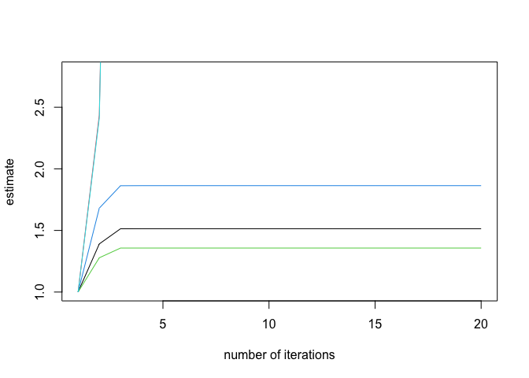

# detectseparation 

<!-- badges: start -->

[](https://CRAN.R-project.org/package=detectseparation)
[](https://www.gnu.org/licenses/gpl-3.0.en.html)
[](https://github.com/ikosmidis/detectseparation/actions/workflows/R-CMD-check.yaml)
[](https://app.codecov.io/gh/ikosmidis/detectseparation)
<!-- badges: end -->

[**detectseparation**](https://github.com/ikosmidis/detectseparation)
provides *pre-fit* and *post-fit* methods for the detection of
separation and of infinite maximum likelihood estimates in binomial
response generalized linear models.

The key methods are `detect_infinite_estimates()`, `detect_separation()`
and `check_infinite_estimates()`.

## Installation

You can install the released version of detectseparation from
[CRAN](https://CRAN.R-project.org) with:

``` r
install.packages("detectseparation")
```

and the development version from [GitHub](https://github.com/) with:

``` r
# install.packages("devtools")
devtools::install_github("ikosmidis/detectseparation", ref = "develop")
```

## Detecting and checking for Infinite maximum likelihood estimates

Heinze and Schemper (2002) used a logistic regression model to analyze
data from a study on endometrial cancer (see, Agresti 2015, sec. 5.7 or
`?endometrial` for more details on the data set). Below, we use these
data with an illustrative model that adds an interaction between `NV`
and `PI` to demonstrate the functionality that **detectseparation**
provides.

``` r
library("detectseparation")
data("endometrial", package = "detectseparation")
endo_glm <- glm(HG ~ NV * PI + EH, family = binomial(), data = endometrial)
theta_mle <- coef(endo_glm)
summary(endo_glm)
#> 
#> Call:
#> glm(formula = HG ~ NV * PI + EH, family = binomial(), data = endometrial)
#> 
#> Coefficients:
#>               Estimate Std. Error z value Pr(>|z|)    
#> (Intercept)    4.30452    1.63730   2.629 0.008563 ** 
#> NV            17.45132 3580.57190   0.005 0.996111    
#> PI            -0.04218    0.04433  -0.952 0.341333    
#> EH            -2.90261    0.84555  -3.433 0.000597 ***
#> NV:PI          0.03155  144.24712   0.000 0.999825    
#> ---
#> Signif. codes:  0 '***' 0.001 '**' 0.01 '*' 0.05 '.' 0.1 ' ' 1
#> 
#> (Dispersion parameter for binomial family taken to be 1)
#> 
#>     Null deviance: 104.903  on 78  degrees of freedom
#> Residual deviance:  55.393  on 74  degrees of freedom
#> AIC: 65.393
#> 
#> Number of Fisher Scoring iterations: 17
```

The maximum likelihood (ML) estimate of the parameter for `NV` is
actually infinite. The reported, apparently finite value is merely due
to false convergence of the iterative estimation procedure. The same is
true for the estimated standard error, and, hence the value
`r round(coef(summary(endo_glm))["NV", "z value"], 3)` for the
$z$-statistic cannot be trusted for inference on the size of the effect
for `NV`.

### `detect_separation()`

`detect_separation()` is a *pre-fit* method, in the sense that it does
not need to estimate the model to detect separation and/or identify
infinite estimates. For example,

``` r
endo_sep <- glm(HG ~ NV * PI + EH, data = endometrial,
                family = binomial("logit"),
                method = "detect_separation")
endo_sep
#> Implementation: ROI | Solver: lpsolve 
#> Separation: TRUE 
#> Existence of maximum likelihood estimates
#> (Intercept)          NV          PI          EH       NV:PI 
#>           0         Inf           0           0      NA(UD) 
#> 0: finite value, Inf: infinity, -Inf: -infinity, NA(A): aliased, NA(UD): undetermined, NA(UR): unresolved
```

The printed coefficient flags distinguish finite estimates (`0`) from
positive or negative infinity (`Inf` or `-Inf`). `NA(UD)` indicates that
there is no unique coefficient limit. Here, the `NV` coefficient tends
to positive infinity, while `NV:PI` can tend to either infinity or any
finite value, provided `NV` grows sufficiently fast.

These annotations are for display: `coef()` returns ordinary numeric
`NA`s, with their interpretation recorded in
`endo_sep$coefficient_status`. See `?detect_separation` for details of
all coefficient classifications, including aliasing and unresolved
numerical calculations.

We can combine the classifications with the fitted coefficients

``` r
coef(endo_glm) + coef(endo_sep)
#> (Intercept)          NV          PI          EH       NV:PI 
#>   4.3045178         Inf  -0.0421834  -2.9026056          NA
```

and similarly with their estimated standard errors

``` r
coef(summary(endo_glm))[, "Std. Error"] + abs(coef(endo_sep))
#> (Intercept)          NV          PI          EH       NV:PI 
#>  1.63729863         Inf  0.04433197  0.84555156          NA
```

We can ask `detect_separation()` not only to detect separation, but
also, if separation is detected, to check whether separation is complete
or quasi-complete. We do this by setting `separation_type = TRUE` in the
`glm()` call

``` r
glm(HG ~ NV * PI + EH, data = endometrial, family = binomial("logit"),
    method = "detect_separation", separation_type = TRUE)
#> Implementation: ROI | Solver: lpsolve 
#> Separation: TRUE (quasi-complete)
#> Existence of maximum likelihood estimates
#> (Intercept)          NV          PI          EH       NV:PI 
#>           0         Inf           0           0      NA(UD) 
#> 0: finite value, Inf: infinity, -Inf: -infinity, NA(A): aliased, NA(UD): undetermined, NA(UR): unresolved
```

We can of course, simply, use the update method on the `glm` object, if
that is available, and change the `method` argument with any extra
options. For example,

``` r
update(endo_glm, method = "detect_separation", separation_type = TRUE)
#> Implementation: ROI | Solver: lpsolve 
#> Separation: TRUE (quasi-complete)
#> Existence of maximum likelihood estimates
#> (Intercept)          NV          PI          EH       NV:PI 
#>           0         Inf           0           0      NA(UD) 
#> 0: finite value, Inf: infinity, -Inf: -infinity, NA(A): aliased, NA(UD): undetermined, NA(UR): unresolved
```

### `check_infinite_estimates()`

Lesaffre and Albert (1989, sec. 4) describe a procedure that can hint on
the occurrence of infinite estimates. In particular, the model is
successively refitted, by increasing the maximum number of allowed
iteratively re-weighted least squares iterations at each step. The
estimated asymptotic standard errors from each step are, then, divided
to the corresponding ones from the first fit. Diverging ratios indicate
loss of information associated with separation. They do not determine
the sign of an infinite coefficient limit or distinguish it from an
undetermined coefficient limit. The following code chunk applies this
process to `endo_glm`.

``` r
(inf_check <- check_infinite_estimates(endo_glm))
#>       (Intercept)           NV       PI       EH        NV:PI
#>  [1,]    1.000000 1.000000e+00 1.000000 1.000000 1.000000e+00
#>  [2,]    1.390660 2.436227e+00 1.278100 1.680866 2.410007e+00
#>  [3,]    1.513574 1.065712e+01 1.356897 1.862917 1.045691e+01
#>  [4,]    1.513979 7.859262e+01 1.356929 1.863567 7.706155e+01
#>  [5,]    1.513986 9.574194e+02 1.356929 1.863579 9.387555e+02
#>  [6,]    1.513986 1.923028e+04 1.356929 1.863579 1.885540e+04
#>  [7,]    1.513986 6.449867e+05 1.356929 1.863579 6.425634e+05
#>  [8,]    1.513986 2.466528e+07 1.356929 1.863579 2.381569e+07
#>  [9,]    1.513986 2.466528e+07 1.356929 1.863579 2.381569e+07
#> [10,]    1.513986 2.466528e+07 1.356929 1.863579 2.381569e+07
#> [11,]    1.513986 2.466528e+07 1.356929 1.863579 2.381569e+07
#> [12,]    1.513986 2.466528e+07 1.356929 1.863579 2.381569e+07
#> [13,]    1.513986 2.466528e+07 1.356929 1.863579 2.381569e+07
#> [14,]    1.513986 2.466528e+07 1.356929 1.863579 2.381569e+07
#> [15,]    1.513986 2.466528e+07 1.356929 1.863579 2.381569e+07
#> [16,]    1.513986 2.466528e+07 1.356929 1.863579 2.381569e+07
#> [17,]    1.513986 2.466528e+07 1.356929 1.863579 2.381569e+07
#> [18,]    1.513986 2.466528e+07 1.356929 1.863579 2.381569e+07
#> [19,]    1.513986 2.466528e+07 1.356929 1.863579 2.381569e+07
#> [20,]    1.513986 2.466528e+07 1.356929 1.863579 2.381569e+07
#> attr(,"class")
#> [1] "inf_check"
plot(inf_check)
```



The ratios grow for both `NV` and `NV:PI`, although only `NV` is
classified as positive infinity; `NV:PI` has an undetermined coefficient
limit.

# References

<div id="refs" class="references csl-bib-body hanging-indent">

<div id="ref-agresti:2015" class="csl-entry">

Agresti, A. 2015. *Foundations of Linear and Generalized Linear Models*.
Wiley Series in Probability and Statistics. Wiley.

</div>

<div id="ref-heinze+schemper:2002" class="csl-entry">

Heinze, G., and M. Schemper. 2002. “A Solution to the Problem of
Separation in Logistic Regression.” *Statistics in Medicine* 21:
2409–19.

</div>

<div id="ref-lesaffre+albert:1989" class="csl-entry">

Lesaffre, E., and A. Albert. 1989. “Partial Separation in Logistic
Discrimination.” *Journal of the Royal Statistical Society. Series B
(Methodological)* 51 (1): 109–16.
<https://www.jstor.org/stable/2345845>.

</div>

</div>
